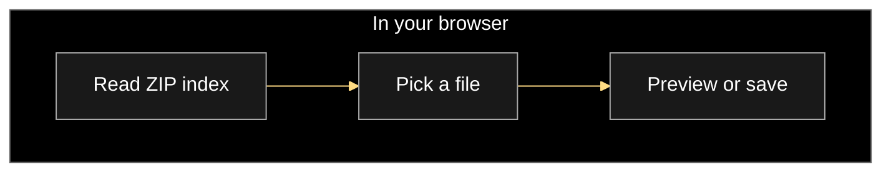

# PeekZip

Browse a ZIP in your browser and download individual files. Local ZIPs stay on your device. Hosted ZIPs use HTTP byte ranges.

[Live demo](https://peekzip.vercel.app/) · [Try the sample map](https://peekzip.vercel.app/#v=1&src=https%3A%2F%2Fpeekzip.vercel.app%2Fsample%2Ffield-notes.zip&file=maps%2Fcontour-study.png)

## Features

- Search by filename or path. Preview text, images, and CSV tables.
- Browse one nested ZIP. Share a selected file for 24 hours without sending the rest of your ZIP.
- Open local files or direct ZIP URLs hosted on the viewer’s own origin.

## How it works



## Run locally

Requires Node.js 24 and pnpm 12.

```sh
pnpm install --frozen-lockfile
pnpm dev
```

## Measured performance

**65,857 bytes** transferred to read the index of a 100 GB, three-entry ZIP64 fixture over loopback HTTP. [Benchmark results](https://github.com/sansynx/peekzip/blob/0d75c7e058bb50fd52875d2aa6a9cb21741f76fd/benchmarks/README.md)

[Contributing](CONTRIBUTING.md) · [Security and limits](SECURITY.md) · [MIT license](LICENSE)
