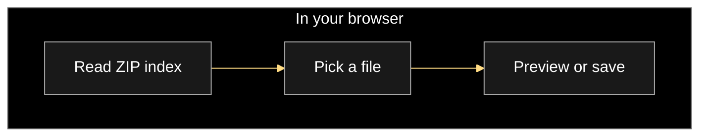

# PeekZip

Open a ZIP in your browser, find a file by name or path, and preview or save it. A local ZIP stays on your device. For a hosted ZIP, PeekZip reads the index first, then requests the byte ranges it needs for your selection.

**[Try PeekZip](https://peekzip.vercel.app/)** · [Open the sample map](https://peekzip.vercel.app/#v=1&src=https%3A%2F%2Fpeekzip.vercel.app%2Fsample%2Ffield-notes.zip&file=maps%2Fcontour-study.png) · [Download the sample ZIP](https://peekzip.vercel.app/sample/field-notes.zip)

## How it works



Use the file list to preview text, CSV tables and images. You can open one ZIP inside the outer archive. On a phone, use **Files** and **Preview** to switch views. The viewer includes a compact version of the diagram rendered with [Pele](https://pele.run/).

## Opening and sharing

| Archive source | How to open it | What a shared link does |
| --- | --- | --- |
| Local file | Choose or drop a ZIP from your device. | Points to the selected entry. The recipient supplies their own copy with the same filename and byte size. |
| Hosted file | Paste a direct `.zip` URL on the same scheme, hostname and port as the viewer. | Opens the selected entry for anyone who can read the source ZIP. They can also browse its other entries. |

On the public viewer, hosted URLs must be on `https://peekzip.vercel.app`. The host must return HTTP `206` with a valid `Content-Range`. PeekZip omits credentials and rejects redirects. URLs containing a query or fragment can be opened directly, but sharing is disabled. For archives hosted elsewhere, download the ZIP and open it locally.

## Limits

| Operation | Browser limit |
| --- | --- |
| Index | 100,000 entries, 32 MiB per index read |
| Preview | 16 MiB per entry. Text displays up to 192 KiB and CSV up to 100 rows × 24 columns. |
| Large stored text or CSV | First 192 KiB only. The whole-file checksum is unverified for a partial preview. |
| Save | 256 MiB per entry |
| Nested ZIP | One child deep. Stored children use byte ranges. Compressed children can expand to 64 MiB. |

Password-protected entries cannot be opened.

## Measured performance

Opening the index of a **100 GB** ZIP transferred **65,857 bytes** and took a median **68 ms** over loopback HTTP. Previewing the first 192 KiB of a stored log transferred another 196,676 bytes. The historical benchmark used three-entry ZIP64 fixtures and 60 Chromium runs across 25, 50 and 100 GB archives on one machine. [Method, raw results and reproduction steps](https://github.com/sansynx/peekzip/blob/0d75c7e058bb50fd52875d2aa6a9cb21741f76fd/benchmarks/README.md)

## Run locally

Use Node.js 24 and pnpm 12.

```sh
pnpm install --frozen-lockfile
pnpm dev
```

Run `pnpm build` to generate the static site in `dist/`. [Contributing and tests](CONTRIBUTING.md) · [Report a security issue](SECURITY.md)

## License

PeekZip uses the [MIT license](LICENSE). Bundled assets have separate notices for [Instrument Sans](public/fonts/InstrumentSans-LICENSE.txt), [Instrument Serif](public/fonts/InstrumentSerif-LICENSE.txt) and [Phosphor icons](public/phosphor-license.txt).
